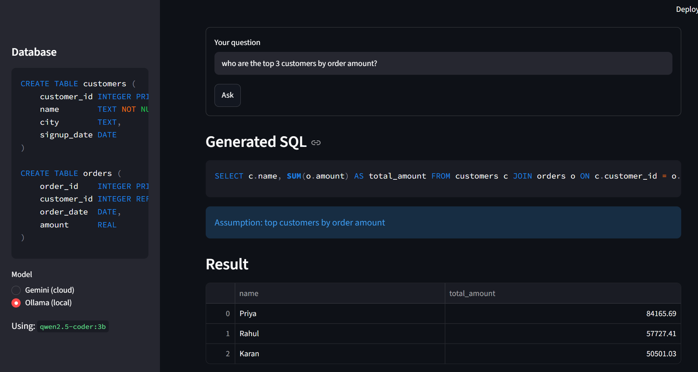
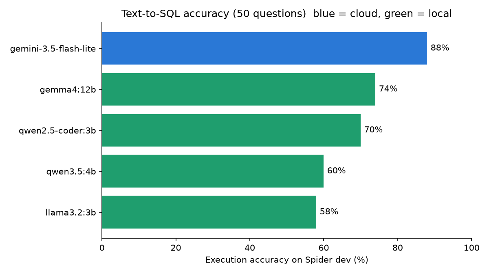
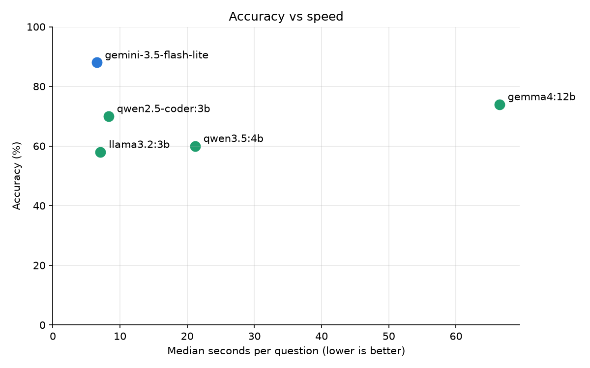

# QueryLocal

**Ask your database in plain English, privately and offline.**

QueryLocal turns a natural-language question into a SQL query, runs it safely on a SQLite database, and shows the result. It works with a cloud model (Google Gemini) or a fully local model (Ollama), so you can choose between accuracy and privacy.



## Features

- **Two backends, one switch:** Gemini (cloud) or any Ollama model (local, works offline).
- **Safe by design:** only a single read-only `SELECT` is allowed. Queries run on a read-only database connection, and anything that writes or changes data is blocked.
- **Self-correction:** if the SQL fails to run, the error is sent back to the model, which gets up to two chances to fix it.
- **Handles vague and impossible questions:** the model states its assumption ("top customers" means highest total order amount), asks a clarifying question, or says the data cannot answer the question, instead of guessing silently.
- **Streamlit web app and a terminal mode.**
- **Benchmarked** on the Spider text-to-SQL dataset: 1 cloud model and 4 local models (results below).

## How it works

```
question + table definitions
        |
        v
  Gemini or Ollama  -->  JSON: ok (SQL + assumption) | clarify | impossible
        |
        v
  safety check (single SELECT only, forbidden keywords blocked)
        |
        v
  run on a read-only SQLite connection
        |
   error? --> send the error back to the model, retry up to 2 times
        |
        v
  show SQL, assumptions and result table
```

## Benchmark: cloud vs local

Every model answered the **same 50 random questions** from the Spider dev set (fixed seed 42). A question counts as correct only if the generated SQL returns exactly the same rows as the reference SQL (execution accuracy). All timings come from a laptop with 16 GB RAM and **no dedicated GPU**, so the local models ran on the CPU.

| Model | Runs | Correct | Median time per question |
|---|---|---|---|
| `gemini-3.5-flash-lite` | cloud | **44/50 (88%)** | 6.5 s |
| `gemma4:12b` | local | 37/50 (74%) | 66.5 s |
| `qwen2.5-coder:3b` | local | 35/50 (70%) | 8.3 s |
| `qwen3.5:4b` | local | 30/50 (60%) | 21.2 s |
| `llama3.2:3b` | local | 29/50 (58%) | 7.1 s |





Per-question results are in [`results/`](results/).

### What the results show

- **The cloud model is clearly more accurate.** Gemini got 10 questions right that `qwen2.5-coder:3b` missed, and the reverse happened only once (sign test p of about 0.01).
- **A small specialist beats a bigger generalist.** The code-trained `qwen2.5-coder:3b` scored 70%, against 60% for the general-purpose `qwen3.5:4b`, and was about 2.5 times faster.
- **Bigger is not automatically better on a CPU.** `gemma4:12b` is 4 times larger than `qwen2.5-coder:3b` but got only 2 more questions right (74% vs 70%, too close to call with 50 questions) and was about 8 times slower.
- **Some misses are caution, not mistakes.** `llama3.2:3b` asked a clarifying question 5 times. The benchmark cannot answer, so those count as wrong.

**Best local choice for everyday use:** `qwen2.5-coder:3b`, which is about as fast as Gemini and keeps all data on your machine.

### Where the small local model falls short

Looking at the 10 questions only Gemini answered correctly:

1. **Wrong tables or columns (about half of the misses).** Three queries failed outright with invented columns (for example `no such column: T2.owner_id`). Others used a plausible but wrong table.
2. **Multi-table joins.** For "the airport with the least flights" the local model grouped the airports table alone and never joined flights, so it counted airports instead of flights.
3. **Negation and set logic.** For "students who do not have a cat" it used `WHERE pettype != 'cat'`, which still returns students who own a cat and another pet. The correct form needs `NOT IN` or `EXCEPT`.

Part of the gap is the metric being strict: one logically correct local query was marked wrong because it left out a duplicated column that the reference answer repeats.

### Experiment: does showing example rows help?

Because wrong table and column choices were the biggest weakness, I tried giving `qwen2.5-coder:3b` three real example rows from every table in the prompt (`--sample-rows 3`).

**Result: no overall change (70% before and after).** 48 of 50 answers were identical. The example rows fixed 1 question, where the model had pulled rank points from the wrong table, and broke 1 simple question, where it invented a column name. So the small model's remaining errors are about **reasoning** (joins, negation), not about missing knowledge of the data.

### Caveats

- 50 questions is a small sample, so treat the percentages as approximate (roughly plus or minus 9 points).
- Gemini timings include network time and free-tier rate-limit waits, so the speed comparison is rough.
- This Gemini model was chosen partly because larger models had very small free daily quotas (20 requests per day).

## Getting started

Requires Python 3.12 and, for local models, [Ollama](https://ollama.com).

```bash
git clone https://github.com/yogesh-builds/QueryLocal.git
cd QueryLocal
python -m venv .venv
.\.venv\Scripts\Activate.ps1        # Windows PowerShell
pip install -r requirements.txt
```

Create a `.env` file with your Gemini key (get one at aistudio.google.com):

```
GEMINI_API_KEY=your_key_here
```

Create the sample database and start the app:

```bash
python scripts/create_sample_db.py
streamlit run src/app.py
```

For the local model:

```bash
ollama pull qwen2.5-coder:3b
```

then pick **Ollama (local)** in the app sidebar.

### Reproduce the benchmark

Download the Spider dataset from https://yale-lily.github.io/spider and unzip it into `data/spider/` (git-ignored). Then:

```bash
python scripts/benchmark.py --backend gemini --n 50 --delay 8
python scripts/benchmark.py --backend ollama --n 50
python scripts/benchmark.py --backend ollama --model gemma4:12b --n 50
python scripts/benchmark.py --backend ollama --model qwen2.5-coder:3b --n 50 --sample-rows 3
python scripts/compare.py results/<first_file>.csv results/<second_file>.csv
python scripts/plot_results.py
```

A stopped run resumes where it left off when you run the same command again.

## Project structure

```
src/text_to_sql.py            engine: prompts, safety check, retries, both backends
src/app.py                    Streamlit interface
scripts/create_sample_db.py   builds the demo shop database
scripts/benchmark.py          runs the Spider benchmark (--model, --sample-rows, --retry-errors)
scripts/compare.py            compares two result files question by question
scripts/plot_results.py       draws the accuracy charts
results/                      benchmark CSVs, comparison table and charts
docs/demo.png                 app screenshot
```

## Ideas for next steps

- Add a few worked examples to the prompt for joins and negation, which target the reasoning errors found above.
- Benchmark on more than 50 questions for tighter error bars.
- Investigate the slower first answer from Gemini.
- Support databases beyond SQLite, and let users upload their own database in the app.

## License

MIT
